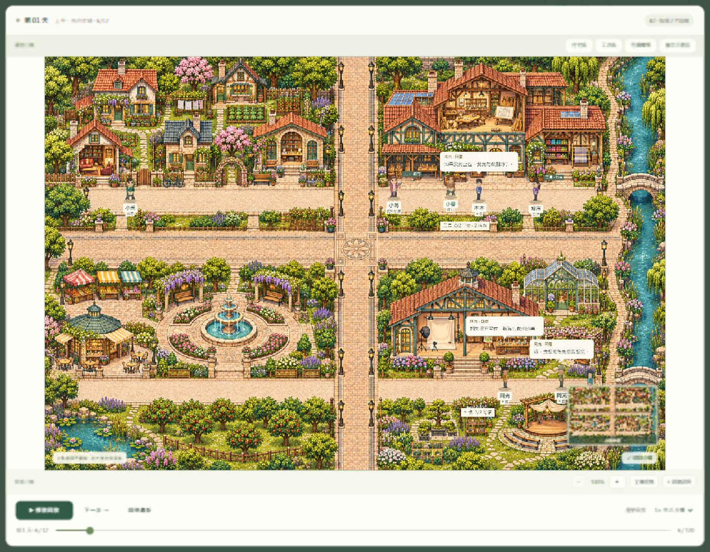
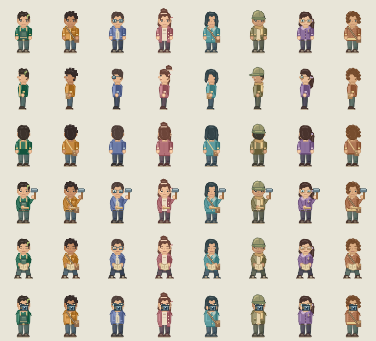

# AI 小鎮｜生活觀察 demo

依研究計畫 **V5 原版**重製的 HTML＋Phaser 互動展示。八位居民在住宅、工坊、公共廣場與活動區活動，從畫面觀察移動、對話、設備借用與合作，也能點選人物查看記憶與交集。

**這是可操作的離線規則型示範，沒有呼叫 LLM，不產生 API 費用。對話與生活軌跡為合成資料，不能納入正式研究。**



## 執行

使用 Node.js 22 或以上。第一次啟動需連網安裝鎖定的 Phaser 套件，之後展示可離線執行：

```sh
npm ci --ignore-scripts --no-audit --no-fund
npm start
```

開啟 <http://127.0.0.1:4173/>。Windows 可雙擊 `Start-Demo.cmd`，首次會自動安裝套件。若 PowerShell 阻擋 npm.ps1，使用 `npm.cmd start` 或 `node server.mjs`。伺服器只監聽本機，關閉伺服器後可用上述方式重新啟動。

## 三分鐘展示

1. 按「開始生活」觀看八位居民的日常。播放速度只改變觀看節奏。
2. 點選地圖人物或下方居民列。「此刻」呈現提議與結算結果；「記憶」呈現決策前實際取得的來源；「互動」呈現已發生的接觸。
3. 點選記憶、小鎮記事或互動網連線，查看原事件並跳回當時。
4. 暫停、逐步或拖動時間軸。從歷史位置按播放會播放已保存的紀錄，抵達最新進度後才繼續執行；完成十日後可從頭回放。
5. 切換「研究觀察」查看指標、完成剩餘十日、執行同種子 A8/B2（或 B3）比較，或匯出與載入完整 JSON。
6. 在「場次設定」選擇 A8、B2 或 B3 和種子，按「建立新場次」才會重設。需要保留舊場次時先匯出。

支援桌面與手機，人物也可用居民按鈕與鍵盤選取。新地圖包含住宅街、工坊街、花園廣場、藝文活動區、河道與橋樑。上方街區按鈕可直接走近觀察；右下小地圖可點選移動鏡頭。鏡頭可從 100% 放大至 350%，放大後拖曳平移；「跟隨居民」會跟著選取的角色，「全鎮視角」還原鏡頭。「放大小鎮」在頁內展開觀察，按 Escape 可收回，不依賴瀏覽器全螢幕權限。

## 畫面與資料

- HTML 承載觀察介面，Phaser 4.2.1 負責場景、角色 Sprite、動畫、Tween 與鏡頭。套件由本機伺服器提供，不依賴 CDN。
- 地景改為細緻像素風格的完整街區美術，包含屋頂剖開的室內陳設、庭院、市集、溫室、河道、石橋與舞台。背景由內建 imagegen 產生並存於專案，沒有遠端圖片或字型依賴。
- 展示世界為 2400×1600 座標，畫面用獨立鏡頭觀看。建築、室內家具與裝飾物是視覺場景，未新增研究地點、設備或室內活動規則。
- 八位居民重繪為每幀 64×96、每人 30 幀的原創人物，有四向走路、工作、休息、交談及拍照姿態。髮型、衣著與配件依角色名字保持一致，地圖與側欄共用同一人物素材。
- 角色依圖上的前街、中央大道及噴泉外環移動，搭配水紋與傍晚燈光。人物站位與路徑皆是展示座標；研究判定仍採四個區域。
- 暫停會凍結正在進行的動作；逐步前進可走完單次過場。偏好減少動態時直接定位並停止循環動畫。
- 人物所在區域、設備占用及對話均來自引擎紀錄。區域內站位、步道路徑與時段色調是展示安排，不作空間研究量測。
- 泡泡只使用當步實際成功的對話事件；無效提議不會被畫成已發生的對話。
- 記憶顯示「決策前」的觀察，人物位置與設備顯示「結算後」狀態；剛借到的設備標示下一時段可用。
- 互動線從有效回覆或完成合作計算，不是預設友情值。所有回放查詢皆截止於目前游標，不使用未來資訊。
- 舊記憶與互動來源從完整事件紀錄查詢，並非只查畫面近期片段。
- 日常策略有鬆散行程、情境文字及可見過往接觸的輕微選擇偏好。它是透明的示範規則，不預先指定朋友、小團體或條件效果，也不代表 LLM 或記憶因果證據。



## 保留的 V5 規則

八位角色、十日、每日十二時段；每人每時段一個行動，先固定快照、收齊提議後統一結算。充裕 A8 對照低可用量 B2/B3，設備持有上限每人一件，借到後兩時段可用。合作須完成邀請、接受、正確設備與雙方同邀請的 work/join。

主指標 Y 使用 D6–D10：至少三個互動日、雙方都曾在窗口內發起且於 D10 結束前驗證，合格角色對除以 28；並列 2／4 日門檻。固定三人核心以全部 56 組三人組計算，不以共同活動代替。零分母為 NA，未完成十日時不顯示最終 Y。

詳見 [規則對照](docs/protocol.md)、[實驗安排](docs/experiment-plan.md)及[驗證紀錄](docs/validation.md)。

## 匯出與相容性

匯出包含**全部已執行時段**，不受回放游標影響。載入上限 20 MB，會用原提議重新結算並核對全部事件、觀察與狀態；成功後才替換目前場次，並停在開頭等待播放。

展示版本為 **0.4.0**。引擎規則及 `demo-0.1.0` 回放格式保持不變，因此已保存的舊版紀錄仍可重播。本次街區美術升級沒有修改 v0.2 的生活策略或研究引擎；重播從不重新執行策略。

## 驗證

```sh
npm test
npm run simulate -- 20261103 2
```

測試涵蓋同步、容量競爭、設備時限、合作、跨日、共同發起、記憶隔離、主指標、三人核心、設限、完整回放、行為可重現性、展示動作與事件的一致性、回放畫面資料不變性及伺服器範圍。`simulate` 在忽略版控的 `output/` 產生示範與配對紀錄。

## 尚未實作

真實模型決策、日終模型反思、API 用量與費用、服務重試／檢查點恢復、正式抽樣及配對統計推論尚未接入。記憶容量採 UTF-8 bytes / 3 近似，並非模型 tokenizer。FNV 校驗用於意外不一致檢查，不是密碼學簽章。

本版沒有改變設備主對照，也沒有執行校準、凍結先導或正式研究。儲存庫不含研究 PDF、雲端文件、憑證或真實個人資料。

## 授權

Phaser 4.2.1 使用 MIT 授權，安裝後可查看 [本機套件授權](http://127.0.0.1:4173/vendor/phaser.LICENSE.txt)。新街區背景由內建 imagegen 產生，人物由本專案程式原創繪製；來源、提示詞及保存位置見[美術說明](docs/art-direction-v0.4.md)。舊版截圖和程式保留在檔案及 Git 歷史中。
