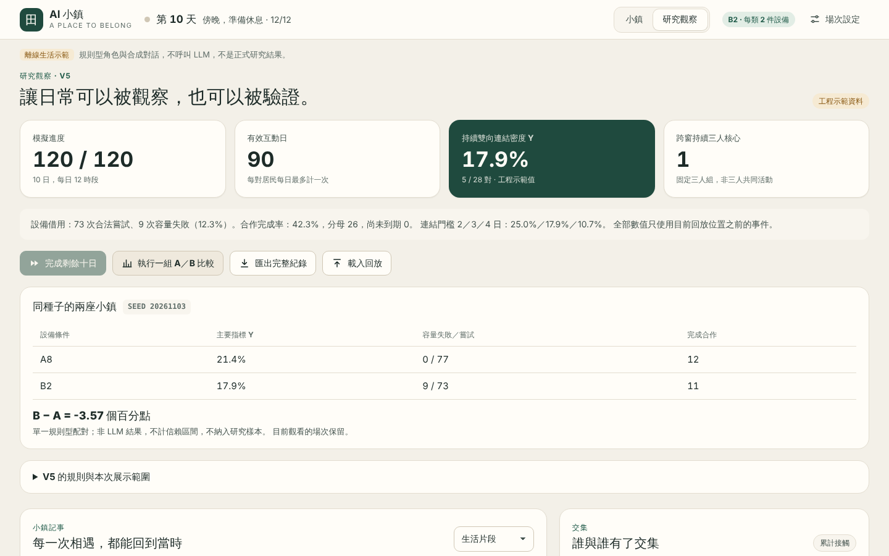
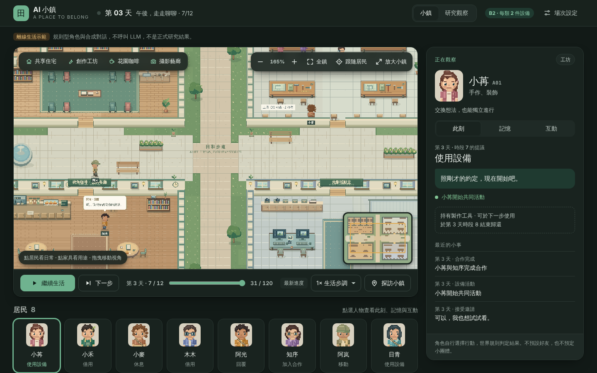
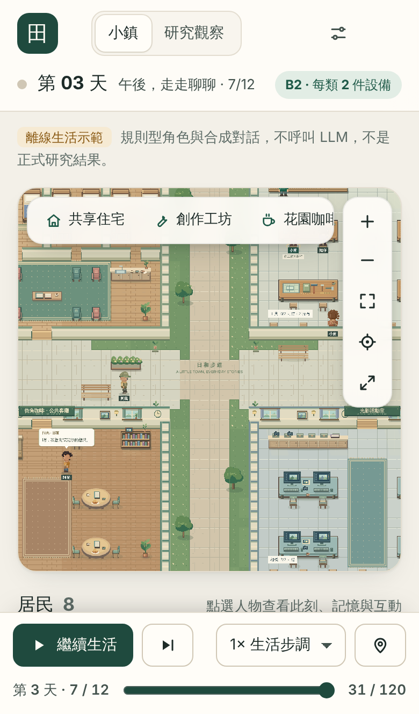
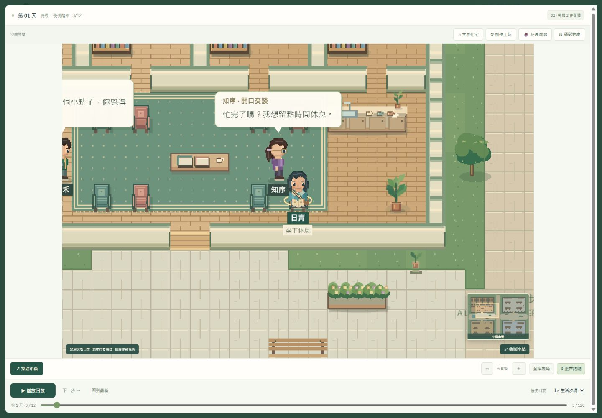

# AI 小鎮｜可走進去的生活空間

依研究計畫 **V5 原版**重製的 HTML＋Phaser 互動展示。以 Gather 經典像素空間為體驗參考，八位居民在共享住宅、工坊、咖啡公共客廳與攝影活動室活動。可以觀察居民進出房間、在家具旁工作和交談，也可以作為訪客親自走進小鎮。地圖與美術為本專案原創，未使用 Gather 的程式或素材。

**這是可操作的離線規則型示範，沒有呼叫 LLM，不產生 API 費用。對話與生活軌跡為合成資料，不能納入正式研究。**


## 執行

使用 Node.js 22 或以上。第一次啟動需連網安裝鎖定的 Phaser 套件，之後展示可離線執行：

```sh
npm ci --ignore-scripts --no-audit --no-fund
npm start
```

開啟 <http://127.0.0.1:4173/>。Windows 可雙擊 `Start-Demo.cmd`，首次會自動安裝套件。若 PowerShell 阻擋 npm.ps1，使用 `npm.cmd start` 或 `node server.mjs`。伺服器只監聽本機，關閉伺服器後可用上述方式重新啟動。

## 三分鐘展示

1. 按「開始生活」觀看八位居民的日常。播放速度只改變觀看節奏。
2. 點選地圖人物或居民列。「此刻」呈現提議與結算結果；「記憶」呈現決策前實際取得的來源；「互動」呈現已發生的接觸。
3. 點選記憶、小鎮記事或互動網連線，查看原事件並跳回當時。
4. 暫停、逐步或拖動時間軸。從歷史位置按播放會播放已保存的紀錄，抵達最新進度後才繼續執行；完成十日後可從頭回放。
5. 在頂部切換到「研究觀察」檢視：查看指標、完成剩餘十日、執行同種子 A8/B2（或 B3）比較，或匯出與載入完整 JSON。小鎮記事與互動網在兩個檢視都可使用；從事件跳回某個時段會回到小鎮檢視。
6. 在「場次設定」選擇 A8、B2 或 B3 和種子，按「建立新場次」才會重設。需要保留舊場次時先匯出。

支援桌面與手機。按「探訪小鎮」加入一位僅供探索的訪客，點地面自動走到目的地；桌面可在地圖取得焦點後使用 WASD／方向鍵，按 E 查看附近家具。點家具會走到其可達位置並顯示說明，點居民會查看其日常。訪客不參與八人模擬，不增加互動數或改變研究結果。

畫面左上的街區按鈕可切換住宅、工坊、咖啡公共客廳與攝影活動室；右上是縮放（100%–350%）、全鎮視角、跟隨居民與放大小鎮，右下小地圖可移動視角，拖曳可平移。「放大小鎮」在頁內展開觀察，按 Escape 可收回。播放、下一步、時間軸、速度與探訪集中在畫面下方的播放列；手機上這一列固定在螢幕底部。

## 介面（v0.8）

v0.8 重新設計觀察介面：頂部列整合日期、時段、播放狀態、檢視切換與場次設定；小鎮畫面為主，鏡頭與街區控制浮在畫面上；居民列在畫面下方，右側觀察面板在捲動時固定；研究觀察改為獨立檢視。字級與對比提高，圖示改用專案內的 SVG，並依系統設定提供深色模式。研究規則、策略、記憶、指標與回放格式均未改變。



| 深色模式 | 手機 |
| --- | --- |
|  |  |

## 畫面與資料

- HTML 承載觀察介面，Phaser 4.2.1 負責場景、角色 Sprite、動畫、Tween 與鏡頭。套件由本機伺服器提供，不依賴 CDN。
- 地圖為 2048×1536、32 像素格的原創像素場景，包含四間可進出建築、住宅隔間、地板、牆壁、門口、沙發、書架、工作桌、咖啡桌、器材櫃與戶外花園。
- v0.6 細化木作、織物、書架、工具、咖啡吧檯、影像桌與庭園細節；縮小房間招牌，選取居民時才展開詳細活動與設備標籤。
- 美術、家具位置與通行格使用同一份地圖定義。家具為獨立前景，與角色按位置排序；尋路會避開牆壁、桌面及噴泉，從門口連接室內外。
- 八位居民以固定像素網格重繪為更清楚的頭身比例，保留每幀 64×96，擴充至每人 192 幀；髮型、服裝、配件與四向動作維持同一身份。地圖與側欄共用人物素材。
- 成功的休息、工作及對話對應座椅、工作位置與靠近交談者的展示站位；這些座標僅呈現已有事件，不增加研究行動或重新判定互動距離。
- 畫面中的座位、床鋪及工作桌並非額外研究設備。可用工具／相機數仍由 V5 的 A8、B2 或 B3 決定。
- v0.7 人物放大約 39%，依移動距離跨步，並播放坐下／站起與較安靜的交談動作。自動播放等待人物完成位移與坐定；可切換 2×／4× 加快。
- 暫停會凍結正在進行的動作；逐步前進可走完單次過場。偏好減少動態時直接定位並停止循環動畫。
- 人物所在區域、設備占用及對話均來自引擎紀錄。區域內站位、步道路徑與時段色調是展示安排，不作空間研究量測。
- 泡泡只使用當步實際成功的對話事件；無效提議不會被畫成已發生的對話。
- 記憶顯示「決策前」的觀察，人物位置與設備顯示「結算後」狀態；剛借到的設備標示下一時段可用。
- 互動線從有效回覆或完成合作計算，不是預設友情值。所有回放查詢皆截止於目前游標，不使用未來資訊。
- 舊記憶與互動來源從完整事件紀錄查詢，並非只查畫面近期片段。
- 日常策略有鬆散行程、情境文字及可見過往接觸的輕微選擇偏好。它是透明的示範規則，不預先指定朋友、小團體或條件效果，也不代表 LLM 或記憶因果證據。



## 保留的 V5 規則

八位角色、十日、每日十二時段；每人每時段一個行動，先固定快照、收齊提議後統一結算。充裕 A8 對照低可用量 B2/B3，設備持有上限每人一件，借到後兩時段可用。合作須完成邀請、接受、正確設備與雙方同邀請的 work/join。

主指標 Y 使用 D6–D10：至少三個互動日、雙方都曾在窗口內發起且於 D10 結束前驗證，合格角色對除以 28；並列 2／4 日門檻。固定三人核心以全部 56 組三人組計算，不以共同活動代替。零分母為 NA，未完成十日時不顯示最終 Y。

詳見 [規則對照](docs/protocol.md)、[實驗安排](docs/experiment-plan.md)及[驗證紀錄](docs/validation.md)。

## 匯出與相容性

匯出包含**全部已執行時段**，不受回放游標影響。載入上限 20 MB，會用原提議重新結算並核對全部事件、觀察與狀態；成功後才替換目前場次，並停在開頭等待播放。

展示版本為 **0.8.0**。引擎規則及 `demo-0.1.0` 回放格式保持不變，因此已保存的舊版紀錄仍可重播。歷次美術與介面升級都沒有修改 v0.2 的生活策略或研究引擎；重播從不重新執行策略。

## 程式結構

所有程式都是瀏覽器可直接載入的 ES 模組，沒有建置步驟。研究引擎不依賴畫面，可在 Node 單獨執行。

| 部分 | 檔案 | 內容 |
| --- | --- | --- |
| 研究引擎 | `src/config.js` | 時鐘、街區、角色設定與可重現的種子亂數、校驗值 |
| | `src/engine.js` | 每時段結算：依序處理回覆、交談、邀請／借還／移動、工作、加入、邀請到期、設備歸還 |
| | `src/memory.js` | 決策前的觀察與記憶檢索（近期事件＋六筆最相關的較早事件，容量上限） |
| | `src/metrics.js` | 主指標 Y、敏感度門檻、三人核心與設備／合作統計 |
| | `src/policy.js` | 離線示範規則，依優先順序排列的具名規則 |
| | `src/replay.js` | 匯出與完整驗證後的重新載入 |
| | `src/runner-worker.js` | 在背景執行完成十日、配對比較與載入驗證 |
| 小鎮畫面 | `src/town-map.js` | 格狀地圖、房間、牆、家具、通行與尋路、小地圖 |
| | `src/activity-anchors.js` | 依已發生的事件決定居民在畫面上的站位與座位 |
| | `src/town-view-model.js`、`src/presentation.js` | 每個時段的畫面資料、姿勢、路徑與對話泡泡內容 |
| | `src/town-scene.js` | Phaser 場景：鏡頭、居民動畫、對話泡泡與訪客 |
| | `src/character-motion.js`、`src/resident-motion.js` | 步行與坐下節奏、人物圖集的動作分段 |
| | `src/speech-bubbles.js`、`src/visitor-art.js` | 泡泡排版、訪客圖集 |
| 美術 | `src/pixel-canvas.js` | 共用的像素繪圖基本函式 |
| | `src/town-assets.js`、`src/environment-detail.js`、`src/resident-art.js` | 以程式繪製的地面、牆、家具與八位居民 |
| 頁面 | `app.js` | 播放、背景工作與事件連接 |
| | `src/ui/` | 面板 HTML、小鎮記事、文字標籤與 DOM 小工具 |
| | `index.html`、`styles.css`、`server.mjs` | 頁面、樣式與僅限本機的靜態伺服器 |

格式以 Prettier 統一（`npm run format`，第一次需連網下載）。三個美術檔是逐筆排列的像素資料，列在 `.prettierignore`。

## 驗證

```sh
npm test
npm run simulate -- 20261103 2
```

測試涵蓋同步、容量競爭、設備時限、合作、跨日、共同發起、記憶隔離、記憶檢索與校驗值對照原始寫法、主指標、三人核心、設限、完整回放、行為可重現性、展示動作與事件的一致性、回放畫面資料不變性、泡泡排版與繪圖小工具及伺服器範圍。`simulate` 在忽略版控的 `output/` 產生示範與配對紀錄。

## 尚未實作

真實模型決策、日終模型反思、API 用量與費用、服務重試／檢查點恢復、正式抽樣及配對統計推論尚未接入。記憶容量採 UTF-8 bytes / 3 近似，並非模型 tokenizer。FNV 校驗用於意外不一致檢查，不是密碼學簽章。

本版沒有改變設備主對照，也沒有執行校準、凍結先導或正式研究。儲存庫不含研究 PDF、雲端文件、憑證或真實個人資料。

## 授權

Phaser 4.2.1 使用 MIT 授權，安裝後可查看 [本機套件授權](http://127.0.0.1:4173/vendor/phaser.LICENSE.txt)。v0.6 的室內外場景、家具與人物由本專案程式原創繪製，詳見[人物動作與 imagegen 使用紀錄](docs/motion-design-v0.7.md)、[美術設計](docs/art-direction-v0.6.md)與[空間與互動設計](docs/spatial-design-v0.5.md)。v0.4 的 imagegen 背景、美術說明與截圖保留在專案，原程式保留在 Git 歷史。
