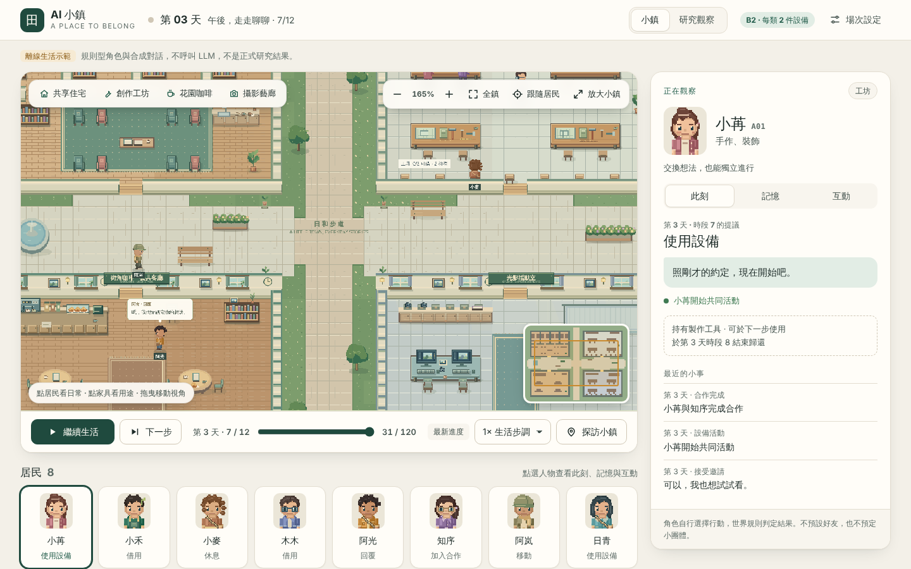

# AI 小鎮｜走進八個人的生活

八位居民在一座像素小鎮裡過十天：起床、去工坊做東西、在咖啡廳聊天、借相機、約人一起完成作品。你可以播放、暫停、倒回任何一刻，看每個人當下想做什麼、記得什麼、和誰有了交集，也可以化身訪客走進房子裡看看。

這是研究計畫 **V5** 的互動展示：把「設備數量會不會影響人與人之間的持續互動」這個研究設計，做成一個能逐步觀察、也能逐筆查證的小鎮。

> [!IMPORTANT]
> 這是**離線的規則型示範**。居民由透明的示範規則驅動，不呼叫 LLM，不產生 API 費用；對話與生活軌跡都是合成資料，**不能作為正式研究結果**。



## 快速開始

需要 [Node.js](https://nodejs.org/) 22 或以上。第一次需要連網安裝 Phaser，之後可完全離線執行。

```sh
npm ci --ignore-scripts --no-audit --no-fund
```

```sh
npm start
```

打開 <http://127.0.0.1:4173/>。伺服器只監聽本機；要換連接埠可設定 `PORT`。

**Windows**：雙擊 `Start-Demo.cmd`，第一次會自動安裝並開啟瀏覽器。若 PowerShell 擋住 `npm.ps1`，改用 `npm.cmd start` 或 `node server.mjs`。

## 怎麼看

### 小鎮檢視

1. 按 **開始生活**。播放速度（1×／2×／4×）只改變觀看節奏，不影響結果。
2. 點地圖上的人物或下方的居民卡，右側面板會顯示：
   - **此刻**：這個時段的提議，以及世界規則判定的結果（成功或為什麼沒成立）。
   - **記憶**：做決定之前實際拿到的事件。綠邊是這一步有引用的記憶。
   - **互動**：截至目前，和誰完成過有效回覆或合作。
3. 點任何記憶、記事或互動連線，會打開原始事件，並可以「回到這個時段」。
4. 用 **下一步** 或拖動時間軸回到過去。從過去按播放，會重播已保存的紀錄，到最新進度才繼續往下模擬。

地圖左上可以直接前往四個街區；右上是縮放（100%–350%）、全鎮視角、跟隨居民與放大小鎮；右下小地圖可以點選移動視角。

### 研究觀察檢視

從頂部切換到 **研究觀察**，可以：

- 查看模擬進度、有效互動日、主指標 Y 與跨窗持續三人核心。所有數值都只計算到目前回放位置。
- **完成剩餘十日**，或 **執行一組 A／B 比較**（同一個種子，A8 對 B2 或 B3）。
- **匯出完整紀錄**（JSON）或 **載入回放**。

小鎮記事與互動網在兩個檢視都看得到。要換設備條件或種子，從右上 **場次設定** 建立新場次；舊場次需要保留的話請先匯出。

### 探訪模式

按 **探訪小鎮** 會出現一位只用來探索的訪客：點地面走過去，點家具會走近並顯示說明。訪客不屬於八人模擬，不會增加互動，也不會改變任何研究數值。

### 鍵盤

| 按鍵 | 作用 |
| --- | --- |
| `W` `A` `S` `D`／方向鍵 | 探訪時移動訪客（地圖需取得焦點） |
| `E` | 探訪時查看附近的家具 |
| `Esc` | 收回放大的小鎮、關閉對話框 |
| `←` `→` `Home` `End` | 切換「此刻／記憶／互動」分頁 |
| `Enter`／空白鍵 | 在互動網上選取居民或連線 |

支援桌面與手機，並依系統設定切換深色模式。

| 研究觀察 | 深色模式 | 手機 |
| --- | --- | --- |
|  |  |  |

## 這個小鎮在模擬什麼

**世界**：八位居民、四個街區（住宅、工坊、公共廣場／咖啡廳、活動室），十天，每天十二個時段，共 120 個時段。

**一個時段怎麼進行**：每位居民根據自己看到的狀況提出一個行動（交談、回覆、邀請、接受、借用、歸還、使用設備、加入、移動、散步、休息、等待）。系統先固定這一刻的快照，收齊八份提議後才統一結算，所以誰先寫下提議不影響結果；只有搶同一件設備或同一個預約時段時，才依該時段的種子順序決定。

**設備條件**是研究的主要對照：工坊的製作工具與活動室的攝影設備，每類各有 8 件（A8，充裕）或 2、3 件（B2、B3，不足）。每人最多持有一件，借到後在接下來兩個時段可用。

**合作**必須完整走完：第 t 時段邀請 → t+1 對方接受、邀請者借設備 → t+2 雙方用同一份邀請執行「使用設備」與「加入」。少一步就不算。

**主指標 Y（持續雙向連結密度）**：在第 6–10 天，一對居民至少有三個互動日，而且雙方都曾在這段期間主動發起、並在第 10 天結束前得到回應。符合的組合數除以全部 28 組。另外也列出 2 日與 4 日門檻，以及跨前後五天都持續的三人核心。

完整規則見 [規則對照](docs/protocol.md) 與 [實驗安排](docs/experiment-plan.md)。

### 畫面上的哪些是研究資料

- **來自研究引擎**：居民所在的街區、行動與結果、對話內容、設備的借還、互動與各項指標。
- **只是展示安排**：街區裡站在哪一張椅子、走哪條路、坐下與走路的動畫、傍晚的色調、訪客。這些位置是依已發生的事件擺放的，不參與任何判定。
- 對話泡泡只會畫出當步真的成立的對話；沒成立的提議不會被畫成發生過。
- 記憶面板顯示的是「做決定之前」拿到的資訊；人物位置與設備顯示的是「結算之後」的狀態。
- 互動連線只來自有效回覆或完成的合作，不是預設的好感度；所有回放查詢都只用到目前位置之前的資料。
- 居民的行為規則包含鬆散的作息、情境台詞，以及對記得的人略微偏好。這是透明的示範規則，不預先指定朋友、小團體或任何條件效果。

### 回放與匯出

匯出檔包含**全部已執行的時段**，不受目前回放位置影響。載入時（上限 20 MB）會用檔案裡的原始提議重新結算一次，逐筆核對事件、觀察與校驗值，全部吻合才會取代目前場次。重播從不重新執行行為規則。

回放格式 `demo-0.1.0` 從 v0.2 起沒有變過，舊版匯出的紀錄可以直接載入。

## 開發

| 指令 | 作用 |
| --- | --- |
| `npm start` | 啟動本機伺服器（預設連接埠 4173） |
| `npm test` | 執行全部測試 |
| `npm run simulate -- 20261103 2` | 以種子 20261103、B2 跑完十日，驗證回放，並在 `output/` 寫出紀錄與 A／B 比較 |
| `npm run format` | 以 Prettier 統一格式（第一次需要連網） |

所有程式都是瀏覽器可直接載入的 ES 模組，沒有建置步驟。研究引擎不依賴畫面，可以單獨在 Node 執行。

| 部分 | 檔案 | 內容 |
| --- | --- | --- |
| 研究引擎 | `src/config.js` | 時鐘、街區、角色設定、可重現的種子亂數與校驗值 |
| | `src/engine.js` | 每個時段的結算：回覆、交談、邀請／借還／移動、使用設備、加入、邀請到期、設備歸還 |
| | `src/memory.js` | 決策前的觀察與記憶檢索（近期事件，加上最相關的六筆較早事件，有容量上限） |
| | `src/metrics.js` | 主指標 Y、門檻敏感度、三人核心、設備與合作統計 |
| | `src/policy.js` | 示範用的行為規則，依優先順序排列 |
| | `src/replay.js` | 匯出，以及完整驗證後的載入 |
| | `src/runner-worker.js` | 在背景完成十日、執行 A／B 比較、驗證載入的檔案 |
| 小鎮畫面 | `src/town-map.js` | 格狀地圖、房間、牆、家具、通行與尋路、小地圖 |
| | `src/activity-anchors.js` | 依已發生的事件決定居民在畫面上的位置與座位 |
| | `src/town-view-model.js`、`src/presentation.js` | 每個時段的畫面資料、姿勢、路徑與對話泡泡 |
| | `src/town-scene.js` | Phaser 場景：鏡頭、居民動畫、對話泡泡與訪客 |
| | `src/character-motion.js`、`src/resident-motion.js` | 走路與坐下的節奏、人物動作分段 |
| | `src/speech-bubbles.js`、`src/visitor-art.js` | 對話泡泡排版、訪客圖 |
| 美術 | `src/pixel-canvas.js` | 共用的像素繪圖函式 |
| | `src/town-assets.js`、`src/environment-detail.js`、`src/resident-art.js` | 用程式繪製的地面、牆、家具與八位居民 |
| 頁面 | `app.js` | 播放、背景工作與事件連接 |
| | `src/ui/` | 面板內容、小鎮記事、文字標籤與 DOM 小工具 |
| | `index.html`、`styles.css`、`server.mjs` | 頁面、樣式（淺色與深色主題）、只限本機的靜態伺服器 |

三個美術檔是逐筆排列的像素資料，列在 `.prettierignore`，不交給 Prettier 排版。

測試涵蓋同步結算、設備競爭與時限、合作、跨日、共同發起、記憶隔離與檢索、主指標與三人核心、完整回放、結果可重現、畫面動作與事件一致、對話泡泡排版，以及伺服器只開放允許的檔案。每次修改的檢查過程記錄在 [驗證紀錄](docs/validation.md)。

## 限制與尚未實作

- 尚未接入：真實模型決策、日終反思、API 用量與費用、服務重試與檢查點恢復、正式抽樣與配對統計推論。
- 記憶容量用「UTF-8 位元組 ÷ 3」近似，不是模型的 tokenizer。
- 校驗值（FNV）只用來發現意外的不一致，不是密碼學簽章。
- 尚未執行校準、凍結先導或正式研究。本儲存庫不含研究 PDF、雲端文件、憑證或真實個人資料。

## 文件

- [規則對照](docs/protocol.md)：V5 規則與本示範的對應，以及工程上的界線
- [實驗安排](docs/experiment-plan.md)：從示範到正式實驗的階段、場數與分析方法
- [驗證紀錄](docs/validation.md)：各版本的修改與檢查結果，也是版本歷史
- [人物動作設計](docs/motion-design-v0.7.md)、[美術設計](docs/art-direction-v0.6.md)、[空間與互動設計](docs/spatial-design-v0.5.md)

## 授權與素材

[Phaser](https://phaser.io/) 4.2.1 採 MIT 授權，啟動後可在 <http://127.0.0.1:4173/vendor/phaser.LICENSE.txt> 查看。套件由本機伺服器提供，不依賴 CDN。

地圖、家具、八位居民與介面圖示都由本專案的程式原創繪製。體驗上參考 Gather 的像素空間，但沒有使用 Gather 的程式或素材。v0.4 以 imagegen 產生的背景、美術說明與截圖保留在 `assets/` 與 `docs/`，舊程式保留在 Git 歷史。
