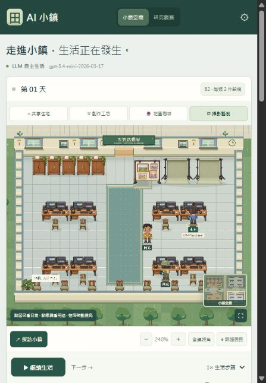

# AI 小鎮｜可走進去的生活空間

依研究計畫 **V5 原版**重製的 HTML＋Phaser 互動展示。以 Gather 經典像素空間為體驗參考，八位居民在共享住宅、工坊、咖啡公共客廳與攝影活動室活動。可以觀察居民進出房間、在家具旁工作和交談，也可以作為訪客親自走進小鎮。地圖與美術為本專案原創，未使用 Gather 的程式或素材。

**預設為離線規則型示範：沒有呼叫 LLM，不產生 API 費用，對話與生活軌跡為合成資料。v0.8 另提供「LLM 自主決策」模式，只在你按下按鈕時才向模型送出請求。兩種模式的結果都是工程示範／試跑，不能視為正式研究結果。**



## 執行

使用 Node.js 22 或以上。第一次啟動需連網安裝鎖定的 Phaser 套件，之後展示可離線執行：

```sh
npm ci --ignore-scripts --no-audit --no-fund
npm start
```

開啟 <http://127.0.0.1:4173/>。Windows 可雙擊 `Start-Demo.cmd`，首次會自動安裝套件。若 PowerShell 阻擋 npm.ps1，使用 `npm.cmd start` 或 `node server.mjs`。伺服器只監聽本機，關閉伺服器後可用上述方式重新啟動。

## 三分鐘展示

1. 按「開始生活」觀看八位居民的日常。播放速度只改變觀看節奏。
2. 點選地圖人物或居民列。「此刻」呈現提議與結算結果；「記憶」呈現決策前實際取得的來源；「互動」呈現已發生的接觸。
3. 點選記憶、小鎮記事或互動網連線，查看原事件並跳回當時。
4. 暫停、逐步或拖動時間軸。從歷史位置按播放會播放已保存的紀錄，抵達最新進度後才繼續執行；完成十日後可從頭回放。
5. 切換「研究觀察」查看指標、完成剩餘十日、執行同種子 A8/B2（或 B3）比較，或匯出與載入完整 JSON。
6. 在「場次設定」選擇 A8、B2 或 B3 和種子，按「建立新場次」才會重設。需要保留舊場次時先匯出。

## LLM 自主決策（v0.8）

1. 複製 `.env.example` 為 `.env.local`，在本機填入自己的 `OPENAI_API_KEY`（不要提交）。金鑰只由本機伺服器讀取，不會送到網頁；`LLM_CALL_LIMIT` 限制單次服務啟動的請求總數（含失敗），預設 1024。
2. 啟動後開「場次設定」→ 決策方式選「LLM 自主決策」，選擇 6／12／24／120 時段上限、設備條件與種子，按「建立新場次」。更換決策方式一定會建立新場次，進度不會沿用。
3. 載入頁面與建立場次都**不會**呼叫模型。「開始生活」會自動前進到暫停或場次上限，「下一步」只執行一個時段。
4. 每個時段：伺服器先取同一份時段前快照，八位居民各自拿到只屬於自己的觀察與記憶，各送一次獨立的模型請求（Responses API、嚴格結構化輸出，預設模型 `gpt-5.4-mini-2026-03-17`，可用 `OPENAI_MODEL` 覆寫，見 [GPT-5.4 mini 官方模型頁](https://developers.openai.com/api/docs/models/gpt-5.4-mini)）。收齊八份提議後由世界規則統一結算。
5. 若有居民失敗，世界不會前進，也**不會**用規則行動補位；已成功的決策會保留，畫面顯示進度、錯誤與「重試未完成的決策」，重試只補送缺少的居民。可隨時暫停；暫停後不會再開始新的時段。
6. 狀態列顯示請求數、失敗數、輸入／輸出 tokens 與本次服務剩餘額度。居民面板只顯示模型給觀眾看的簡短「公開說明」，以及該步實際引用、且確實提供過的記憶；不保存或顯示思考過程。
7. 「匯出完整紀錄」會附上請求稽核（模型、提示版本與雜湊、觀察雜湊、用量、失敗嘗試），不含金鑰。載入這種檔案會重新結算並核對，成功後為**唯讀回放**，播放不呼叫 API。伺服器同時把每個時段的結果存到 `output/llm-runs/`（已忽略版控）。
8. 重新整理頁面會以本機場次重建畫面，包含未完成的時段；若服務已重啟，場次不會保留，頁面會用相同設定建立新場次（尚未送出任何請求）。LLM 場次不提供「完成剩餘十日」與 A／B 比較，不會被離線策略補齊。

離線模式與舊版匯出檔仍可使用，引擎輸出格式不變。

支援桌面與手機。按「探訪小鎮」加入一位僅供探索的訪客，點地面自動走到目的地；桌面可在地圖取得焦點後使用 WASD／方向鍵，按 E 查看附近家具。點家具會走到其可達位置並顯示說明，點居民會查看其日常。訪客不參與八人模擬，不增加互動數或改變研究結果。

「空間導覽」可切換住宅、工坊、咖啡公共客廳與攝影活動室；右下小地圖可移動視角。鏡頭可從 100% 放大至 350%，拖曳可平移。「跟隨居民」會跟著選取的角色，「全鎮視角」還原鏡頭。「放大小鎮」在頁內展開觀察，按 Escape 可收回。

## 畫面與資料

- HTML 承載觀察介面，Phaser 4.2.1 負責場景、角色 Sprite、動畫、Tween 與鏡頭。套件由本機伺服器提供，不依賴 CDN。
- 地圖為 2048×1536、32 像素格的原創像素場景，包含四間可進出建築、住宅隔間、地板、牆壁、門口、沙發、書架、工作桌、咖啡桌、器材櫃與戶外花園。
- v0.6 細化木作、織物、書架、工具、咖啡吧檯、影像桌與庭園細節；縮小房間招牌，選取居民時才展開詳細活動與設備標籤。
- 美術、家具位置與通行格使用同一份地圖定義。家具為獨立前景，與角色按位置排序；尋路會避開牆壁、桌面及噴泉，從門口連接室內外。
- 八位居民以固定像素網格重繪為更清楚的頭身比例，保留每幀 64×96，擴充至每人 192 幀；髮型、服裝、配件與四向動作維持同一身份。地圖與側欄共用人物素材。
- 成功的休息、工作及對話對應座椅、工作位置與靠近交談者的展示站位；這些座標僅呈現已有事件，不增加研究行動或重新判定互動距離。
- 畫面中的座位、床鋪及工作桌並非額外研究設備。可用工具／相機數仍由 V5 的 A8、B2 或 B3 決定。
- v0.7 人物放大約 39%，依移動距離跨步，並播放坐下／站起與較安靜的交談動作。自動播放等待人物完成位移與坐定；可切換 2×／4× 加快。
- 暫停會凍結正在進行的動作；逐步前進可走完單次過場。偏好減少動態時直接定位並停止循環動畫。
- 人物所在區域、設備占用及對話均來自引擎紀錄。區域內站位、步道路徑與時段色調是展示安排，不作空間研究量測。
- 泡泡只使用當步實際成功的對話事件；無效提議不會被畫成已發生的對話。
- 記憶顯示「決策前」的觀察，人物位置與設備顯示「結算後」狀態；剛借到的設備標示下一時段可用。
- 互動線從有效回覆或完成合作計算，不是預設友情值。所有回放查詢皆截止於目前游標，不使用未來資訊。
- 舊記憶與互動來源從完整事件紀錄查詢，並非只查畫面近期片段。
- 日常策略有鬆散行程、情境文字及可見過往接觸的輕微選擇偏好。它是透明的示範規則，不預先指定朋友、小團體或條件效果，也不代表 LLM 或記憶因果證據。


## 保留的 V5 規則

八位角色、十日、每日十二時段；每人每時段一個行動，先固定快照、收齊提議後統一結算。充裕 A8 對照低可用量 B2/B3，設備持有上限每人一件，借到後兩時段可用。合作須完成邀請、接受、正確設備與雙方同邀請的 work/join。

主指標 Y 使用 D6–D10：至少三個互動日、雙方都曾在窗口內發起且於 D10 結束前驗證，合格角色對除以 28；並列 2／4 日門檻。固定三人核心以全部 56 組三人組計算，不以共同活動代替。零分母為 NA，未完成十日時不顯示最終 Y。

詳見 [規則對照](docs/protocol.md)、[實驗安排](docs/experiment-plan.md)及[驗證紀錄](docs/validation.md)。

## 匯出與相容性

匯出包含**全部已執行時段**，不受回放游標影響。載入上限 20 MB，會用原提議重新結算並核對全部事件、觀察與狀態；成功後才替換目前場次，並停在開頭等待播放。

展示版本為 **0.8.0**。引擎規則及 `demo-0.1.0` 回放格式保持不變，因此已保存的舊版紀錄仍可重播。本次美術與介面升級沒有修改 v0.2 的生活策略或研究引擎；重播從不重新執行策略。

## 驗證

```sh
npm test
npm run simulate -- 20261103 2
```

測試涵蓋同步、容量競爭、設備時限、合作、跨日、共同發起、記憶隔離、主指標、三人核心、設限、完整回放、行為可重現性、展示動作與事件的一致性、回放畫面資料不變性及伺服器範圍。`simulate` 在忽略版控的 `output/` 產生示範與配對紀錄。

## 尚未實作

v0.8 的 LLM 模式是單機工程試跑：沒有日終模型反思、費用換算、跨服務重啟的場次恢復（只有逐時段保存的檔案）、正式抽樣、校準或配對統計推論，也沒有自動重試。記憶容量採 UTF-8 bytes / 3 近似，並非模型 tokenizer。FNV 校驗用於意外不一致檢查，不是密碼學簽章。

本版沒有改變設備主對照，也沒有執行校準、凍結先導或正式研究。儲存庫不含研究 PDF、雲端文件、憑證或真實個人資料。

## v0.8 畫面與素材

- 開場鏡頭停在布置好的共享公寓；「全鎮視角」可看整個小鎮，「跟隨居民」與「探訪小鎮」維持原樣。
- 家具改用 `assets/furniture-atlas-v0.8.png`（1536×1024 RGBA，6×4 個 256 px 格，每格一件家具）。瀏覽器載入後以 Canvas 裁切透明邊界、保持比例、貼齊底部縮放；圖集缺失或某格不透明時，該物件改用原本的程式繪製家具。碰撞格、座位與接近點沿用同一份地圖定義，未被圖集取代的只有工具牆與側向咖啡座椅。
- 新增可點選的生活細節：沙發、共享餐桌、黑膠唱片機、房間洗手檯、攝影作品展示架與數盆植物，另有廚房磁磚、地毯與牆邊陰影。
- 素材來源：該圖集為本專案先前產生的原創家具圖集，不含第三方或 Gather 素材。產生工具與提示紀錄未隨這份程式碼保存，發佈前請維護者補充於 `docs/`。

## 授權

Phaser 4.2.1 使用 MIT 授權，安裝後可查看 [本機套件授權](http://127.0.0.1:4173/vendor/phaser.LICENSE.txt)。v0.6 的室內外場景、家具與人物由本專案程式原創繪製，詳見[人物動作與 imagegen 使用紀錄](docs/motion-design-v0.7.md)、[美術設計](docs/art-direction-v0.6.md)與[空間與互動設計](docs/spatial-design-v0.5.md)。v0.4 的 imagegen 背景、美術說明與截圖保留在專案，原程式保留在 Git 歷史。
