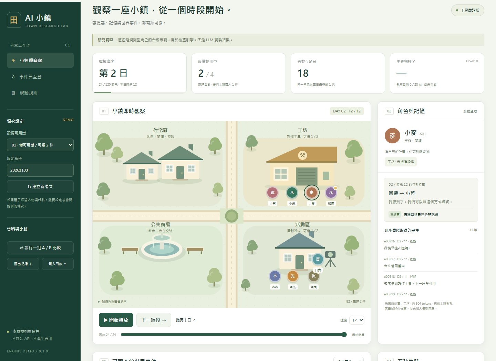

# AI 小鎮｜研究實驗室 demo

八位角色、四個區域、兩種設備。可逐時段觀察提議如何成為世界事件，檢查記憶來源，並將完整紀錄匯出、重播與重算。

**這是規則型角色的工程驗證版，沒有呼叫 LLM，也不產生 API 費用。所有輸出都是合成示範，不得併入正式研究資料。**



## 立即執行

需要 Node.js 22 或以上；不需 npm install，也不需 API key。

```sh
npm start
```

開啟 <http://127.0.0.1:4173>。Windows 也可雙擊 `Start-Demo.cmd`。視窗保持開啟，按 Ctrl+C 停止。

若 PowerShell 阻擋 npm.ps1，可使用 `npm.cmd start` 或直接執行 `node server.mjs`。預設只監聽本機，不公開對外。

## 建議的五分鐘展示

1. 保留 B2 與種子 20261103，按「下一時段」觀察角色移動、交談與借用。
2. 點選角色，查看該步提議、引擎結果，以及決策時實際取得的事件。
3. 按「開始播放」或「跑完十日」。十日未完成時，主指標 Y 保持未完成標示。
4. 拖動回放時間軸。畫面、指標及記憶會回到當時紀錄；繼續執行會接續最新時段。
5. 匯出 JSON，換條件建立新場次，再載入原檔。引擎重新結算保存的提議，核對事件、記憶與狀態，不重新選擇行動。
6. 「執行一組 A／B 比較」會以同種子建立獨立的 A8 與 B2（或 B3）世界，顯示工程配對差值，不覆蓋目前場次，不產生信賴區間。

匯出以**完整已執行場次**為準，與回放游標位置無關。匯入上限為 20 MB；不符版本、遭修改或不一致的紀錄會被拒絕。

## 已實作的研究規則

- 每場 10 日，每日 12 時段，8 位角色每時段各提議一個行動；角色設定及起點按種子配置。
- 先固定觀察，收齊提議後統一結算，下一時段才可讀取新事件。設備競爭順序按種子固定並記錄。
- 充裕 A8／低可用量 B2、B3。每人兩類合計最多持有一件；持有中不可離區。
- s 借到後，s+1、s+2 可用，s+2 結束歸還；同時段歸還的設備不能提早被借走。
- t 邀請 t+2 合作；t+1 接受／借用；t+2 同一邀請的 work、join，位置與設備均符合才成功。接受不等於成功，單人活動另記。
- 有效回覆引用同一對話中對方的訊息，最多相距 2 個絕對時段；每則訊息最多被配對一次。同時互 talk 合併，後續有效回覆才驗證兩位共同發起者。
- 互動按完成日計，每對每天最多一日。發起日獨立保存，reply、accept 與續談不計新發起。
- 主指標 Y：D6–D10 至少 3 個互動日，雙方均在該窗口有效發起，且 D10 結束前已驗證，合格對數除以 28。並列 2／4 日敏感度。
- 固定三人核心分 D1–D5、D6–D10 建網，邊需至少 2 個互動日；保留重疊與跨窗持續。
- 角色只取得可見事件。近期 2 時段；較早事件依 0.7 Jaccard + 0.3 新近性取前 6 筆，新近性半衰期 12 時段。實際提供的 ID、順序、內容及截取情形保留於決策紀錄。

細部操作規則與 demo 範圍見 [規則對照](docs/protocol.md)。下一階段見 [實驗安排](docs/experiment-plan.md)。

## 驗證與命令列

```sh
npm test
npm run simulate -- 20261103 2
```

測試涵蓋時序、同步、容量競爭、合作、跨日、共同發起、來源隔離、指標、行政設限、完整回放與伺服器存取範圍。另以多個種子與 2／3／8 件配置驗證設備及記憶不變條件。

`simulate` 產生 `output/demo-replay.json` 與 `output/demo-pair.json`，並驗證完整回放。`output/` 不納入 Git。GitHub Actions 會執行相同測試；Actions 設定依 [checkout](https://github.com/actions/checkout) 與 [setup-node](https://github.com/actions/setup-node) 官方文件，固定至已查核的版本 SHA。

## 專案結構

| 檔案 | 職責 |
| --- | --- |
| `src/engine.js` | 純函式世界結算、邀請、對話、設備及事件 |
| `src/memory.js` | 角色可見資料、檢索、實際提供紀錄 |
| `src/metrics.js` | 由事件重算 Y、敏感度、核心與合作率 |
| `src/policy.js` | 固定種子的規則型示範策略，非 LLM |
| `src/replay.js` | 提議重播、事件／記憶／狀態一致性檢查 |
| `src/runner-worker.js` | 在背景執行完整場次、配對及匯入 |
| `app.js` / `styles.css` | 繁體中文操作介面及程式繪製的 SVG 小鎮 |
| `test/` | 人工案例、不變條件與伺服器測試 |

## 與正式系統的差距

尚未接入 GPT-6 Luna 或其他模型；沒有真實 usage、延遲、服務重試／恢復或日終模型反思。人物短名與規則型策略僅供辨識與流程示範，不是凍結後的人格／提示。

記憶約 900 tokens 使用 UTF-8 bytes / 3 的粗估，並非模型 tokenizer。角色策略主要依目前狀態產生動作，檢索紀錄用於驗證資料管線，不能當成記憶影響選擇的證據。

目前 FNV 校驗用於偵測意外不一致，**不是加密簽章或防惡意竄改保證**。正式版須加入版本封存、完整雜湊、API 呼叫及費用帳本、檢查點與失敗協定。尚未完成校準、四場凍結先導或正式 12 組配對。

本儲存庫不含原研究 PDF、簡報、憑證或真實個人資料。介面插圖為專案內 SVG，無第三方圖片或遠端字型依賴。
