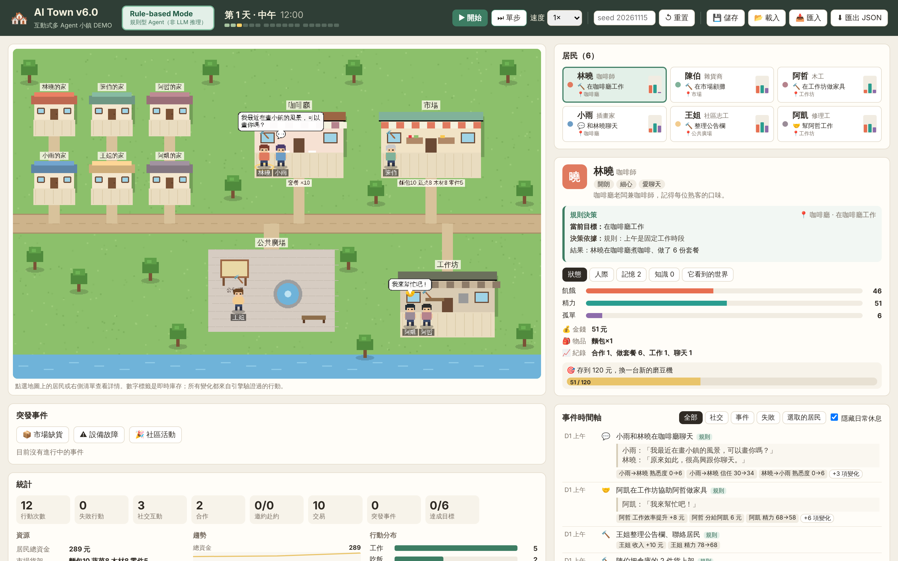
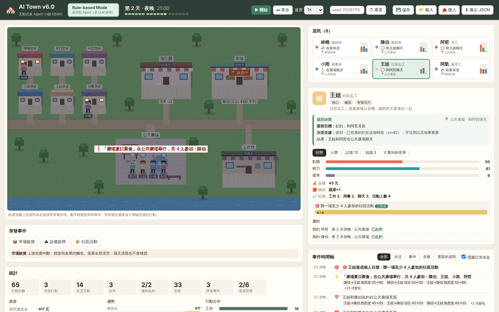

# AI Town v6.0 — Interactive DEMO

六位居民在一座像素小鎮裡生活三天：上班、吃飯、購物、聊天、互相邀約與幫忙；中途會遇到**咖啡機故障、市場缺貨、社區聚會**。所有行動都由引擎驗證後才會改變世界，你可以在瀏覽器裡播放、暫停、單步、調速、重置，點任何一位居民看它的需求、金錢、目標、記憶、知道的消息，以及它做決策時「唯一看得到」的資料。

- 前端：React + TypeScript + Vite，小鎮用 **Phaser 3** 畫成 2D 像素風
- 後端：Python + **FastAPI**，模擬邏輯與畫面完全分離
- Agent：預設是**規則型（Rule-based Mode）**，不需要 API Key；保留 **LLM Provider Adapter**，設定 Key 後可改用 Claude 決策

> [!NOTE]
> 預設模式的居民行為來自**透明的規則**（見 `backend/aitown/agents/rule_based.py`），畫面上會明確標示「Rule-based Mode／規則決策」，不會把規則行為說成 LLM 推理。





## 快速開始

需要 **Python 3.11+** 與 **Node.js 20+**。開兩個終端機：

**1. 後端（FastAPI，埠號 8000）**

```bash
cd v6/backend
python -m venv .venv
```

```bash
source .venv/bin/activate        # Windows：.venv\Scripts\activate
```

```bash
pip install -r requirements-dev.txt
```

```bash
python -m aitown serve
```

**2. 前端（Vite，埠號 5173）**

```bash
cd v6/frontend
npm ci
```

```bash
npm run dev
```

打開 <http://localhost:5173/>。Vite 會把 `/api` 轉給 `http://127.0.0.1:8000`。

**只開一個伺服器也可以**：先在 `v6/frontend` 執行 `npm run build`，再啟動後端，直接打開 <http://127.0.0.1:8000/>（FastAPI 會提供建置好的前端）。

### 跑測試

```bash
cd v6/backend && .venv/bin/python -m pytest -q
```

```bash
cd v6/frontend && npm run build
```

`npm run build` 會先做 TypeScript 型別檢查（`tsc --noEmit`）再打包。

### 不開畫面跑一次實驗

```bash
cd v6/backend && .venv/bin/python -m aitown run --seed 42 --days 3 --out run-42.json
```

換不同 `--seed` 就能重複做多次實驗；匯出的 JSON 和畫面上「匯出 JSON」的格式相同。

## 畫面怎麼用

| 區塊 | 內容 |
| --- | --- |
| 頂部列 | **模式標章**（Rule-based Mode／LLM Mode）、目前第幾天哪個時段、▶ 開始／⏸ 暫停／⏭ 單步、速度 0.5×～4×、輸入 seed 後 ↺ 重置、💾 儲存／📂 載入（伺服器 `saves/quicksave.json`）、📥 匯入／⬇ 匯出 JSON |
| 小鎮地圖 | 居民沿道路走到目的地；頭上圖示是當前行動（❌ 代表失敗），對話會跳出泡泡。市場、咖啡廳下方的數字是**即時庫存**；故障會冒煙並顯示 ⚠，缺貨會掛 📦，社區活動會掛彩旗；夜晚有燈光變化 |
| 突發事件 | 手動觸發「市場缺貨」「設備故障」「社區活動」，並列出進行中的事件 |
| 統計 | 行動次數、失敗次數、社交互動、合作、邀約赴約、交易、事件、達成目標；資源（總資金、市場貨架與倉庫、咖啡廳套餐、故障設備）；帳本稽核；趨勢折線；行動分布 |
| 居民清單 | 六張卡片：正在做什麼、在哪裡、飢餓／精力／孤單小長條。點卡片或點地圖上的人都可以選取 |
| 居民詳情 | 職業、個性、決策來源與理由、當前目標、行動結果；分頁「狀態」（需求、金錢、物品、個人目標進度、邀約）、「人際」（熟悉度、信任、互動次數）、「記憶」、「知識」（每則消息是親眼看到、看公告欄還是聽誰說的）、「它看到的世界」（Agent 決策時拿到的完整輸入） |
| 事件時間軸 | 每一筆行動與事件，含失敗原因、對話內容、以及造成的**狀態變化**（例如「市場貨架 麵包 8→0」「小雨→林曉 熟悉度 0→6」）。可篩選社交、事件、失敗、選取的居民 |

## 小鎮規則

### 時間與需求
- 預設 3 天 × 6 個時段（清晨、上午、中午、下午、傍晚、夜晚），每按一次「單步」推進一個時段。
- 每位居民有 **飢餓、精力、孤單**（0–100）、**金錢**、**物品**、**職業**、**個人長期目標**與**當前短期目標**。需求每個時段自然變化，睡覺、吃飯、聊天、參加活動會改善。

### 地點
六棟住宅（只有屋主能進）、市場（清晨～傍晚）、咖啡廳（上午～傍晚）、工作坊（上午～下午）、公共廣場與公告欄（全天）。

### 居民

| 居民 | 職業 | 工作 | 個人目標 |
| --- | --- | --- | --- |
| 林曉 | 咖啡師 | 在咖啡廳做套餐（有蔬菜時做得更多），需要咖啡機正常 | 存到 120 元 |
| 陳伯 | 雜貨商 | 把市場倉庫的貨上架；別人購物的錢付給他 | 和 3 位鄰居混熟 |
| 阿哲 | 木工 | 用 2 份木材做一件家具（+30 元），需要電鋸正常 | 完成 3 件家具 |
| 小雨 | 插畫家 | 在咖啡廳、廣場或家裡畫插畫（+16 元） | 交到 2 位朋友 |
| 王姐 | 社區志工 | 把重要消息貼上公告欄、邀請大家參加活動 | 辦一場 ≥4 人的社區活動 |
| 阿凱 | 修理工 | 帶零件修好故障設備（收修理費），沒事就在工作坊接零工 | 修好 2 台設備 |

### 行動與驗證
每個時段每人提出**一個結構化行動**：`move` 移動、`work` 工作、`rest` 休息、`eat` 吃飯、`shop` 購物、`chat` 聊天、`invite` 邀約、`cooperate` 合作。引擎會檢查：地點是否存在／是否營業／能不能進去、身上錢夠不夠、貨架有沒有貨、精力和飢餓是否允許工作、設備是否故障、聊天或合作的對象是否真的在同一個地點、對方是否真的在工作……任何一項不符合，行動就失敗並寫下原因，**世界不會被改變**。

同一個時段大家「同時」行動：先移動，再依 seed 決定的公平順序搶有限的庫存（兩個人搶最後一個麵包，只有一個人買得到）。

所有金錢與庫存變化都經過帳本（`ledger.py`）：先檢查全部條件再一次寫入、同一筆行動不會重複入帳、任何數值都不會變成負數；統計面板的「帳本稽核」會即時檢查。

### 非全知視角
每位居民只知道：自己的狀態、記憶、人際關係；**當下所在地點**看得到的東西（在場的人、貨架、設備、公告欄）；鎮上的公開資訊（地圖、營業時間、價格、大家的職業與上班地點）。它看不到別人的需求、金錢和記憶，也不知道遠處發生的事——消息只能透過親眼看到、公告欄或聊天傳開。點「它看到的世界」分頁就能看到這份資料。

### 社交的後果
- **聊天**：雙方熟悉度、信任、互動次數增加，孤單下降，並各自分享一則對方不知道的重要消息。
- **邀約**：當面約定未來某個時段在某地見面，對方依關係與個性決定答不答應。兩人都到 → 關係大幅提升；一方沒到 → 等的人對爽約者信任 −12，並記住「被放鴿子」。
- **合作**：到正在工作的人身邊幫忙，對方收入（或咖啡廳產量）增加並分錢給幫手，雙方信任提升。對方沒在工作就會失敗。
- **社區活動**：在場的所有人兩兩增加熟悉度，主辦人的目標進度依到場人數計算。

### 突發事件（預設排程，也可以手動觸發）
| 事件 | 預設時間 | 對世界的影響 |
| --- | --- | --- |
| 設備故障 | 第 1 天中午 | 咖啡機（或電鋸、冷藏櫃）停擺，相關工作全部失敗；只有在場的人看得到，老闆要去找阿凱，阿凱要帶零件到現場修 |
| 市場缺貨 | 第 2 天清晨 | 貨架與倉庫的麵包、蔬菜歸零，隔天清晨也不送貨；不知情的人會白跑一趟；結束後供應商補貨，要等陳伯上架 |
| 社區活動 | 第 2 天上午宣布 | 王姐在公告欄宣布當天傍晚的廣場聚會，並四處當面邀請；知道消息、答應邀約的人才會到場 |

## LLM Mode（選用）

1. 安裝套件：`pip install -r requirements-llm.txt`
2. 在**後端**設定環境變數（API Key 只存在後端，前端永遠拿不到）：

```bash
export ANTHROPIC_API_KEY=你的金鑰
```

```bash
AI_TOWN_MODE=llm python -m aitown serve
```

3. 頂部模式標章會變成紫色的 **LLM Mode**；也可以在畫面上按「切換到 LLM／規則」並重置世界。

- 預設模型是 `claude-opus-5-5`，可用 `AI_TOWN_LLM_MODEL` 改成其他模型（例如成本較低的 `claude-haiku-5-5`）。每個時段每位居民呼叫一次，3 天 6 人約 108 次。
- 模型透過 **Structured Outputs** 回傳固定格式的行動，仍然要經過引擎驗證，說什麼都不能直接改變世界。
- 呼叫失敗、拒答或格式錯誤時，這位居民改用規則決策，畫面標示為橘色的「**LLM 失敗 → 規則備援**」並顯示原因；時間軸上也會標「備援」。
- 沒有設定 Key 或沒裝套件時，即使要求 LLM Mode 也會自動以規則型完整運行，並在畫面上方說明原因。

## 程式結構

```
v6/
├── backend/
│   ├── aitown/
│   │   ├── config.py          地點、物品、職業、居民、預設事件（純資料）
│   │   ├── models.py          世界狀態（Pydantic，可直接存成 JSON）
│   │   ├── world.py           建立初始世界；居民數量不限（住宅自動排列）
│   │   ├── engine.py          主迴圈：送貨 → 事件 → 決策 → 結算 → 需求 → 觀察 → 目標
│   │   ├── actions.py         八種行動的驗證與結算、約定檢查
│   │   ├── ledger.py          帳本：原子交易、防重複、防負數、稽核
│   │   ├── perception.py      每位居民的非全知觀察；時段結束時更新信念
│   │   ├── social.py          記憶、知識傳播、人際關係
│   │   ├── events.py          市場缺貨、設備故障、社區活動
│   │   ├── goals.py           個人目標進度（由世界狀態計算）
│   │   ├── stats.py           研究統計與資源快照
│   │   ├── persistence.py     存檔、讀檔、匯出
│   │   ├── api.py             FastAPI 路由（並提供建置好的前端）
│   │   └── agents/
│   │       ├── base.py        DecisionProvider 介面
│   │       ├── rule_based.py  規則型 Agent（預設）
│   │       └── llm.py         Claude Adapter（含規則備援）
│   └── tests/                 pytest，31 項
└── frontend/src/
    ├── App.tsx                自動播放迴圈、資料流
    ├── api.ts                 呼叫後端（不含任何金鑰）
    ├── game/TownScene.ts      Phaser 場景：像素地圖、角色走路、泡泡、事件特效
    └── components/            頂部列、居民清單與詳情、時間軸、統計、事件按鈕
```

### API

| 方法 | 路徑 | 用途 |
| --- | --- | --- |
| GET | `/api/state` | 完整世界狀態、統計、模式設定 |
| POST | `/api/step` | 推進 `count` 個時段（預設 1），回傳新增的紀錄 |
| POST | `/api/reset` | 重置；可帶 `seed`、`days`、`mode` |
| POST | `/api/events/trigger` | 觸發 `market_shortage`／`equipment_failure`／`community_event` |
| GET | `/api/residents/{id}/perception` | 某位居民此刻的觀察（Agent 的輸入） |
| POST | `/api/save`、`/api/load`；GET `/api/saves` | 伺服器端存檔（名稱只能是英數字） |
| GET | `/api/export` | 下載研究用 JSON（紀錄、交易、邀約、統計、最終狀態） |

## 目前已實現

- 6 位居民、3 天 × 6 時段的完整生活循環（三餐、工作、購物、睡覺），每次執行由 seed 決定、可重現
- 8 種行動與完整的條件驗證；失敗會寫下原因
- 帳本：原子交易、不會負庫存、不會重複交易、即時稽核
- 非全知觀察、記憶、知識在聊天與公告欄之間傳播
- 熟悉度／信任／互動次數；邀約（赴約或被放鴿子）、合作、社區活動都有實際後果
- 三種突發事件（排程＋手動），並會產生連鎖反應（故障 → 找人 → 買零件 → 修理；缺貨 → 白跑 → 補貨）
- 個人目標進度由世界狀態計算
- 觀察介面：地圖、居民清單與詳情、事件時間軸、統計；開始／暫停／單步／調速／重置
- 存檔、讀檔、匯入、匯出 JSON；存檔後繼續跑的結果與不存檔完全相同
- LLM Provider Adapter（Claude）＋規則備援，模式在畫面上清楚標示
- 測試：生活循環、交易不會負庫存與重複、社交紀錄、重置恢復初始世界、存讀檔、事件影響、非全知、LLM 解析與備援、API、12 位居民

## 尚未完成

- **LLM 回應邀約**仍使用規則（LLM 只負責提出每個時段的行動）
- LLM 模式是逐一同步呼叫，6 位居民一個時段約需數秒～十幾秒；尚未做平行呼叫、快取或費用統計
- 尚未用真實 API Key 實際跑過完整的 LLM 模擬（已用假客戶端與真實 SDK 的模擬傳輸驗證請求格式與解析）
- 居民在地點之間是「瞬間」抵達，走路動畫只是呈現；沒有路徑阻擋或移動時間成本
- 地圖與 UI 針對 6 位居民設計；12 位以上居民的模擬與測試可以跑，但住宅排版與清單還沒有為大量居民調整
- 依照需求刻意**不做**：完整金融系統、選舉、婚姻、複雜治理
- 多次實驗目前用 CLI 一次跑一個 seed，還沒有批次比較的報表

## 後續整合真實 LLM 的位置

| 位置 | 說明 |
| --- | --- |
| `backend/aitown/agents/llm.py` → `LLMDecisionProvider.decide()` | 每個時段的行動決策（已完成，可換提示詞、模型、加入思考或平行呼叫） |
| 同檔案 `respond_invitation()` | 目前回傳規則結果，改成呼叫模型即可讓 LLM 決定要不要赴約 |
| `backend/aitown/actions.py` → `Resolver.small_talk()`／`reply()` | 規則模式的對話是模板句；LLM 模式下 `say` 已由模型產生，可再讓被搭話的一方也由模型回覆 |
| `backend/aitown/perception.py` → `perceive()` | Agent 的輸入。想加入記憶摘要、反思或長期計畫，從這裡擴充 |
| `backend/aitown/agents/base.py` | 要接其他模型或本地模型，只要實作同一個 `DecisionProvider` 介面 |
